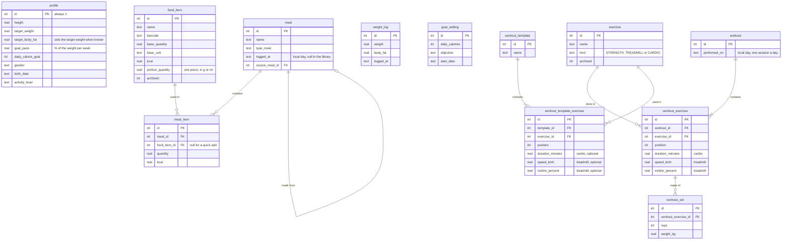

# Developing CatCHMeal

How to build the app from the code, work on it, publish a version, and how its data is stored. To simply install it, download the APK from the [releases](https://github.com/natamun/catchmeal-mobile/releases/latest), as the [README](./README.md) explains. The commit rules are in [CONTRIBUTING.md](./CONTRIBUTING.md).

## Building it yourself

**1. Prepare the computer.** The commands below work on Linux and macOS. On Windows, use them in [WSL](https://learn.microsoft.com/windows/wsl/install).

- **Node.js 22 or newer**, from [nodejs.org](https://nodejs.org) or a version manager such as nvm.
- **The Android SDK and JDK 21.** The simplest way is [Android Studio](https://developer.android.com/studio): its first launch installs the SDK, and it ships a JDK 21. Without it, for instance in WSL, install a JDK 21 (`sudo apt install openjdk-21-jdk`) and the [command-line tools](https://developer.android.com/studio#command-line-tools-only), then run `sdkmanager "platform-tools" "platforms;android-36" "build-tools;36.0.0"`.
- **Two environment variables**, in your `~/.bashrc` or `~/.zshrc`:

  ```bash
  export ANDROID_HOME="$HOME/Android/Sdk"   # macOS: $HOME/Library/Android/sdk
  export JAVA_HOME="/path/to/jdk-21"        # Android Studio's: its jbr folder
  export PATH="$ANDROID_HOME/platform-tools:$PATH"
  ```

**2. Get the project.**

```bash
git clone https://github.com/natamun/catchmeal-mobile.git
cd catchmeal-mobile
npm ci
```

**3. Connect the phone.**

1. On the phone, turn on the developer options: in **Settings > About phone** (on a Samsung, **About phone > Software information**), tap **Build number** seven times.
2. In **Settings > Developer options**, turn on **USB debugging**.
3. Plug the phone into the computer and accept the **Allow USB debugging?** prompt. `adb devices` should now list it as `device`.

> [!TIP]
> On WSL, Windows keeps the USB devices: pass the phone to Linux with [usbipd-win](https://github.com/dorssel/usbipd-win), `usbipd attach --wsl --busid <BUSID> --auto-attach`.

**4. Install.** `make phone` builds and installs the development app, **CatCHMeal dev**. To build the real app, create a release key first (see [Releases](#releases)).

## Commands

| Command | What it does |
|---|---|
| `make check` | Format check, lint, build and tests, like the CI |
| `make format` | Formats the code |
| `make lint` | Fixes what the linter can |
| `make phone` | Builds the development app and installs it on the phone |
| `make apk` | Builds the development app as an APK |
| `make dev` + `make live` | Live development, in two terminals |
| `make release` | Builds the real app, signed, as `release/catchmeal-<version>.apk` |
| `make installRelease` | Installs that APK on the phone, as an update |

The development app (`io.github.natamun.catchmeal.debug`) and the real one (`io.github.natamun.catchmeal`) are two apps side by side, each with its own data: testing never touches the real data.

In live development, the phone loads the code from the computer through the USB cable and reloads on every change. Stop `make live` with Ctrl+C. Both use port 5174, which `DEV_PORT=<port>` changes.

## Code layout

| Folder | Content |
|---|---|
| `src/db` | The database layer: one queue for every statement, transactions, migrations (`PRAGMA user_version`) |
| `src/data` | The business rules and SQL of each feature, tested in Node against a real SQLite database |
| `src/native` | The Android-only parts: back button, native HTTP, backup files, sharing, notifications |
| `src/components`, `src/pages` | The screens; each feature's `api.ts` connects them to `data` |
| `android` | The Android project generated by Capacitor |

## Releases

The version lives in `package.json` alone, in the form major.minor.patch. The settings card shows the one installed, and Android's version number is derived from it (1.2.3 gives 10203), so each version updates the one before.

The real app is signed with a release key kept off the repository: `catchmeal-release.jks` and its password in `.password`, both at the root and ignored by git.

> [!WARNING]
> Android refuses an update signed with another key: lose the key, and the installed app can no longer be updated. Keep a copy of both files off the computer, such as in a password manager. Git ignores them, but `git clean -fdx` would delete them.

To create your own key:

```bash
python3 -c "import secrets; print(secrets.token_urlsafe(32), end='')" > .password
keytool -genkeypair -keystore catchmeal-release.jks -storetype PKCS12 \
  -alias catchmeal -keyalg RSA -keysize 4096 -validity 10000 -dname "CN=CatCHMeal" \
  -storepass:file .password -keypass:file .password
```

For a new version:

1. Raise the version: `npm version minor --no-git-tag-version` (or `patch` for a fix).
2. Build it with `make release`, and update the phone with `make installRelease`.
3. Publish it: push the commits, then create the GitHub release with its APK, `gh release create v<version> release/catchmeal-<version>.apk --title "CatCHMeal <version>" --notes "..."`.

## Data model



- A meal line stores the calories and macros computed when the meal is saved, so editing or archiving a food later leaves past meals unchanged.
- Training sessions are a logbook: their calories are neither estimated nor added to the goals, because the measured expenditure already holds the training.
- Three columns are left from earlier versions and no longer read: `met` in `exercise`, the effort once used to estimate those calories, and `name` and `duration_minutes` in `workout`, empty since the sessions became one a day.
