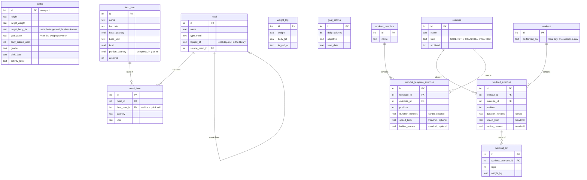

<p align="center">
  
</p>

<h1 align="center">CatCHMeal</h1>

<p align="center">
  A calorie tracker and training logbook for Android, in French.<br>
  No account, no server: everything stays on the phone.
</p>

<p align="center">
  <a href="./LICENSE"></a>
  
  
  
  
</p>

<p align="center">
  <a href="#features">Features</a> ·
  <a href="#installing-on-an-android-phone">Install</a> ·
  <a href="#development">Development</a> ·
  <a href="#releases">Releases</a> ·
  <a href="#data-model">Data model</a>
</p>

---

CatCHMeal logs what you eat, scans barcodes with Open Food Facts, measures your real energy expenditure from your journal and weigh-ins, and recommends calories and macros for your goal. The data lives in SQLite on the device: only the barcode lookups go online.

It started from CatCHMeal, a web app built as a team for the ft_transcendence project at 42, cut down and rebuilt as a single-user phone app.

## Features

### Nutrition

- **Journal**: four sections a day (breakfast, lunch, dinner, snack), with the calorie and macro progress.
- **Barcode scanning**: the camera reads EAN and UPC codes, and [Open Food Facts](https://world.openfoodfacts.org) fills the food form.
- **Food library**: values per 100 g, 100 ml or per piece. Foods are archived rather than deleted, so past meals keep their data.
- **Portions**: a food can have one, such as a biscuit of 12 g, to be logged by the piece ("4 biscuits") and saved in grams. Open Food Facts fills it when their serving is one piece.
- **Meal library and quick add**: meals saved once and logged again in one go, or calories and macros typed by hand.

### Body and goals

- **Weigh-ins** with body fat, fat-free mass, body water and muscle mass.
- **Measured expenditure**: the average of the calories logged, minus the weight trend × 7,700 kcal per kg, over the last four weeks. Until there is enough data, it is estimated from the BMR (Mifflin-St Jeor, or Katch-McArdle with the fat-free mass). A measure that holds the first two weeks of a goal is flagged, since water and glycogen skew it.
- **Recommended goals**: daily calories and macros from a goal (lose fat, lose weight, maintain, build muscle) and a weekly pace, never under the BMR. The protein follows the fat-free mass when the scale tells it.
- **Target body fat**: picked by level (lean, athletic, fit), it sets the target weight from the fat-free mass at each weigh-in.
- **Composition trend**: how the fat and the fat-free mass moved since the goal began, with an alert when the fat rises faster than the fat-free mass while building, or when the fat-free mass falls too fast while losing.

### Training

- **Logbook**, kept like the food journal: one session a day, each exercise once. Strength holds sets of repetitions at a load, the treadmill a duration, speed and slope, other cardio a duration.
- **Training library**: exercises and favorite sessions, each recalling its last values. It starts empty, and an exercise can be created right from its search.
- **Exercise sheet**: records, estimated one-rep max, progress curve and last sessions. Saving a session tells the new records.

### Statistics

- **Charts** over a chosen period: calories, macros and body measures, each measure with its dashed trend and its change per week, set against the pace aimed at.
- **Training**: sessions per week (strength and cardio), volume lifted, cardio time, treadmill distance and climb.
- **AI summary**: the period as text to paste into an AI chat, with the profile, goals and pace, the measured expenditure and its method, the body composition, the meals and the training, day by day or week by week.

### And also

- **Weigh-in reminder**: an optional notification every Sunday morning.
- **Backup and restore**: all the data in one JSON file, shared through Android (Drive, e-mail, Files) and restored all or nothing.
- **Twelve color themes** from known palettes (Graphite, Nord, Dracula, Gruvbox, Catppuccin, Rosé Pine, Tokyo Night, Monokai, Solarized dark and light, navy and coral, Klein and cream), each with two accents.

## Technical stack

| Layer | Tools |
|---|---|
| Interface | React 19, TypeScript, Vite 8, Tailwind CSS 4, React Router, Recharts |
| Android | Capacitor 8, which wraps the web app and gives it native plugins |
| Storage | SQLite through `@capacitor-community/sqlite`, with versioned migrations (`PRAGMA user_version`) |
| Barcodes | zxing-wasm, decoding in the WebView |
| Tests | Vitest: the business rules and the SQL run against a real SQLite database in Node |

### Code layout

| Folder | Content |
|---|---|
| `src/db` | The database layer: one queue for every statement, transactions, migrations |
| `src/data` | The business rules and SQL of each feature, tested in Node |
| `src/native` | The Android-only parts: back button, native HTTP, backup files, sharing, notifications |
| `src/components`, `src/pages` | The screens; each feature's `api.ts` connects them to `data` |
| `android` | The Android project generated by Capacitor |

## Installing on an Android phone

The app is not on the Play Store. It runs on Android 7 or newer.

### Download the APK

1. On the phone, open the [latest release](https://github.com/natamun/catchmeal-mobile/releases/latest) and download `catchmeal-<version>.apk`.
2. Open it from the notification or the **Files** app. Android asks to allow installing apps from this source: allow it, then install. If Play Protect warns about an unknown app, choose to install anyway.
3. For a new version, download its APK and open it the same way: the app is updated in place and keeps its data.

### Build it yourself

**1. Prepare the computer.** The commands below work on Linux and macOS. On Windows, use them in [WSL](https://learn.microsoft.com/windows/wsl/install).

- **Node.js 22 or newer**, from [nodejs.org](https://nodejs.org) or a version manager such as nvm.
- **The Android SDK and JDK 21.** The simplest way is [Android Studio](https://developer.android.com/studio): its first launch installs the SDK, and it ships a JDK 21. Without it, for instance in WSL, install a JDK 21 (`sudo apt install openjdk-21-jdk`) and the [command-line tools](https://developer.android.com/studio#command-line-tools-only), then run `sdkmanager "platform-tools" "platforms;android-36" "build-tools;36.0.0"`.
- **Two environment variables**, in your `~/.bashrc` or `~/.zshrc`:

  ```bash
  export ANDROID_HOME="$HOME/Android/Sdk"   # macOS: $HOME/Library/Android/sdk
  export JAVA_HOME="/path/to/jdk-21"        # Android Studio's: its jbr folder
  export PATH="$ANDROID_HOME/platform-tools:$PATH"
  ```

**2. Get the project.**

```bash
git clone https://github.com/natamun/catchmeal-mobile.git
cd catchmeal-mobile
npm ci
```

**3. Connect the phone.**

1. On the phone, turn on the developer options: in **Settings > About phone** (on a Samsung, **About phone > Software information**), tap **Build number** seven times.
2. In **Settings > Developer options**, turn on **USB debugging**.
3. Plug the phone into the computer and accept the **Allow USB debugging?** prompt. `adb devices` should now list it as `device`.

> [!TIP]
> On WSL, Windows keeps the USB devices: pass the phone to Linux with [usbipd-win](https://github.com/dorssel/usbipd-win), `usbipd attach --wsl --busid <BUSID> --auto-attach`.

**4. Install.** `make phone` builds and installs the development app, named **CatCHMeal dev**: it sits beside the real app, with its own data, and `make apk` gives it as an APK file instead. To build the real app, create a release key first (see [Releases](#releases)), then run `make release` and `make installRelease`.

## Data and backup

> [!WARNING]
> Uninstalling the app deletes its data: export a backup regularly from the profile page. Android also refuses an update signed with another key, so keep a copy of the release key and its password (`~/.android/catchmeal-release.jks` and `.password`) somewhere safe, such as a password manager.

## Development

| Command | What it does |
|---|---|
| `make check` | Format check, lint, build and tests, like the CI |
| `make format` | Formats the code |
| `make lint` | Fixes what the linter can |
| `make phone` | Builds the development app and installs it on the phone |
| `make apk` | Builds the development app as an APK |
| `make dev` + `make live` | Live development, in two terminals |
| `make release` | Builds the real app, signed, as `release/catchmeal-<version>.apk` |
| `make installRelease` | Installs that APK on the phone, as an update |

The development app (`io.github.natamun.catchmeal.debug`) and the real one (`io.github.natamun.catchmeal`) are two apps side by side: testing never touches the real data.

In live development, the phone loads the code from the computer through the USB cable and reloads on every change. Stop `make live` with Ctrl+C. Both use port 5174, which `DEV_PORT=<port>` changes.

## Releases

The version lives in `package.json` alone, in the form major.minor.patch. The settings card shows the one installed, and Android's version number is derived from it (1.2.3 gives 10203), so each version updates the one before.

The real app is signed with a release key kept off the repository: the keystore at `~/.android/catchmeal-release.jks`, its password in `.password` at the root, both ignored by git. To create your own:

```bash
python3 -c "import secrets; print(secrets.token_urlsafe(32), end='')" > .password
keytool -genkeypair -keystore ~/.android/catchmeal-release.jks -storetype PKCS12 \
  -alias catchmeal -keyalg RSA -keysize 4096 -validity 10000 -dname "CN=CatCHMeal" \
  -storepass:file .password -keypass:file .password
```

For a new version:

1. Raise the version: `npm version minor --no-git-tag-version` (or `patch` for a fix).
2. Build it with `make release`, and update the phone with `make installRelease`.
3. Publish it: push the commits, then create the GitHub release with its APK, `gh release create v<version> release/catchmeal-<version>.apk --title "CatCHMeal <version>" --notes "..."`.

## Data model

<details>
<summary>The tables and their links</summary>



</details>

- A meal line stores the calories and macros computed when the meal is saved, so editing or archiving a food later leaves past meals unchanged.
- Training sessions are a logbook: their calories are neither estimated nor added to the goals, because the measured expenditure already holds the training.
- Three columns are left from earlier versions and no longer read: `met` in `exercise`, the effort once used to estimate those calories, and `name` and `duration_minutes` in `workout`, empty since the sessions became one a day.

## Credits

- Built from CatCHMeal, the ft_transcendence team project at 42, under the [MIT license](./LICENSE).
- Food product data comes from [Open Food Facts](https://world.openfoodfacts.org), a free, open and collaborative database licensed under the [Open Database License (ODbL)](https://opendatacommons.org/licenses/odbl/1-0/).
