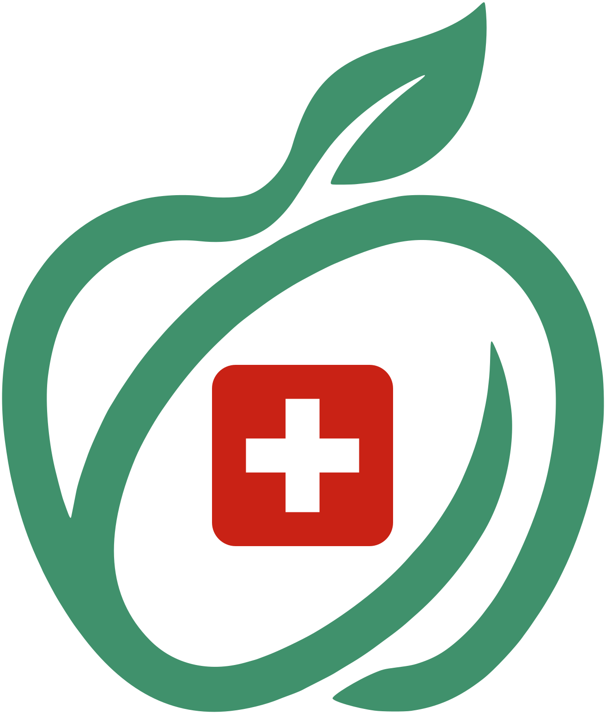

  

<h1 align="center">CatCHMeal</h1>

  A calorie tracker and training logbook for Android, in French. 
  No account, no server: everything stays on the phone.

  
  
  
  
  

  <a href="#features">Features</a> ·
  <a href="#install">Install</a> ·
  <a href="./CONTRIBUTING.md">Development</a>

---

CatCHMeal logs what you eat, scans barcodes with Open Food Facts, keeps your recipes and your shopping list, measures your real energy expenditure from your journal and weigh-ins, and recommends calories and macros for your goal. The data lives on the phone: only the barcode lookups go online.

It started from CatCHMeal, a web app built as a team for the ft_transcendence project at 42, cut down and rebuilt as a single-user phone app.

## Features

### Nutrition

- **Journal**: four sections a day (breakfast, lunch, dinner, snack), with the calorie and macro progress.
- **Barcode scanning**: the camera reads the code, and [Open Food Facts](https://world.openfoodfacts.org) fills the food form.
- **Food library**: values per 100 g, 100 ml or per piece, with an optional portion to log by the piece ("4 biscuits").
- **Meal library and quick add**: meals saved once and logged again in one go, or calories and macros typed by hand.
- **Recipes**: ingredients from the food library, cooking, numbered steps and notes, filtered by category. Each recipe shows its calories and macros per serving and its quantities for any number of servings, and the screen stays on while you cook. A recipe is logged by the serving, and can be sent to an AI chat with your goal to improve it.
- **Shopping list**: foods, meals and recipes added for the servings you need, the same food added up into one line, and free items. You tick the list off in the shop and share it as text.

### Body and goals

- **Weigh-ins** with body fat, fat-free mass, body water and muscle mass.
- **Measured expenditure**: your real daily expenditure, read from the last four weeks of journal and weigh-ins, and estimated until there is enough data.
- **Recommended goals**: daily calories and macros for your goal (lose fat, lose weight, maintain, build muscle) and the weekly pace you pick, the protein following your fat-free mass.
- **Target body fat**: picked by level (lean, athletic, fit), it sets your target weight.
- **Composition trend**: how your fat and fat-free mass moved since the goal began, with an alert when they go the wrong way.

### Training

- **Logbook**, kept like the food journal: strength and cardio in sets, each treadmill set at its own speed and incline, the other machines at their resistance, one session a day.
- **Training library**: your exercises and favorite sessions, each starting from its last sets.
- **Exercise sheet**: records, estimated one-rep max, progress curve and last sessions.

### Statistics

- **Summary** of the chosen period at the top: average calories against the goal, weekday against weekend, protein, weight change with its pace per week, sessions per week.
- **Charts** over a chosen period: calories, macros and body measures, with their trend.
- **Training**: sessions per week, strength and cardio.
- **AI summary**: the period as text to paste into an AI chat and ask about it.

### And also

- **Weigh-in reminder** every Sunday morning, if you want it.
- **Backup and restore** in one file, saved on the phone or shared to a Drive.
- **Twelve color themes** from known palettes, such as Nord, Dracula, Gruvbox or Catppuccin.

## Install

The app is not on the Play Store. It runs on Android 7 or newer.

1. On the phone, open the [latest release](https://github.com/natamun/catchmeal-mobile/releases/latest) and download `catchmeal-<version>.apk`.
2. Open it, and allow installing apps from this source when Android asks. If Play Protect warns about an unknown app, choose to install anyway.
3. For a new version, download its APK and open it the same way: the app is updated and keeps its data. What each version changed is in [CHANGELOG.md](./CHANGELOG.md).

> [!NOTE]
> Your data lives only on the phone, and uninstalling the app deletes it. Save a backup now and then from the profile page, and share one to a Drive.

To build it from the code instead, see [CONTRIBUTING.md](./CONTRIBUTING.md).

## Built with

React 19, TypeScript, Vite, Tailwind CSS and Recharts for the interface; Capacitor 8 for Android; SQLite on the phone; zxing-wasm for the barcodes; Vitest for the tests. How to build, develop and publish it, and how the data is stored: [CONTRIBUTING.md](./CONTRIBUTING.md).

## Credits

- Built from CatCHMeal, the ft_transcendence team project at 42, under the [MIT license](./LICENSE).
- Food product data comes from [Open Food Facts](https://world.openfoodfacts.org), a free, open and collaborative database licensed under the [Open Database License (ODbL)](https://opendatacommons.org/licenses/odbl/1-0/).
