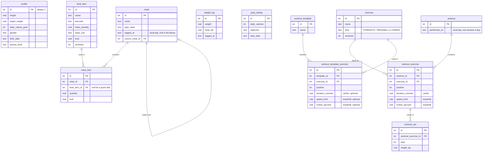

# CatCHMeal

[](./LICENSE)


A personal calorie tracker and training logbook for Android. It runs entirely on the phone: no account, no server, no shared database. The data lives in SQLite on the device, and only the barcode lookup goes online, to Open Food Facts.

It started from CatCHMeal, a web app built as a team for the ft_transcendence project at 42 (see [LICENSE](./LICENSE)), cut down and rebuilt as a single-user phone app.

## Features

- **Journal**: meals logged per day in four sections (breakfast, lunch, dinner, snack), with calorie and macro progress.
- **Food library**: foods with their values per 100 g, 100 ml or per piece, archived instead of deleted so past meals keep their data.
- **Meal library**: meals saved once and logged again in one go.
- **Quick add**: calories and macros logged without a food.
- **Barcode scanning**: the camera reads EAN and UPC codes, and [Open Food Facts](https://world.openfoodfacts.org) fills the food form.
- **Body composition**: weigh-ins with body fat, fat-free mass, body water and muscle mass.
- **Goals**: daily calories and macros recommended from a goal (lose fat, lose weight, maintain, build muscle) and a weekly pace, never under the BMR. The daily expenditure is measured from the last four weeks of journal and weigh-ins, or estimated (Mifflin-St Jeor or Katch-McArdle) until there is enough data. Past goals are kept for the stats.
- **Training logbook**: kept like the food journal. One session a day: its "+" opens the training library, where exercises and favorite sessions (named sets of exercises) are picked, then the values are checked, started from the last time, before they join the day; each exercise appears once a day. Strength holds sets of repetitions at a load, the treadmill a duration, speed and slope, other cardio a duration. An exercise can be created right from its search, and saving tells the new records. The library recalls the last values of every exercise, also inside the favorites, and each exercise opens its own logbook: records, estimated one-rep max, progress and last sessions. The library starts empty: the user adds their own exercises.
- **Statistics**: calorie, macro and body composition charts over a chosen period; for the training, the sessions per week split between strength and cardio, the volume lifted, the cardio time and the treadmill distance and climb; and a summary of the period to paste into an AI chat.
- **Weigh-in reminder**: an optional notification every Sunday morning.
- **Backup and restore**: all the data in one JSON file, shared through Android (Drive, e-mail, Files) and restored all or nothing.
- **Color themes**: twelve themes from known palettes (Graphite, Nord, Dracula, Gruvbox, Catppuccin, Rosé Pine, Tokyo Night, Monokai, Solarized dark and light, navy and coral, Klein and cream), each with two accents, picked in the profile.

## Technical stack

- **React 19**, **TypeScript**, **Vite 8**, **Tailwind CSS 4**, **React Router**, **Recharts**
- **Capacitor 8**: wraps the web app into an Android app and gives it native plugins
- **SQLite** through `@capacitor-community/sqlite`, with versioned migrations (`PRAGMA user_version`)
- **zxing-wasm** for barcode decoding in the WebView
- **Vitest** for the tests: the business rules and the SQL run against a real SQLite database in Node

### Code layout

| Folder | Content |
|---|---|
| `src/db` | The database layer: one queue for every statement, transactions, migrations |
| `src/data` | The business rules and SQL of each feature, tested in Node |
| `src/native` | The Android-only parts: back button, native HTTP, backup files, sharing, notifications |
| `src/components`, `src/pages` | The screens; each feature's `api.ts` connects them to `data` |
| `android` | The Android project generated by Capacitor |

## Data model



A meal line stores the calories and macros computed when the meal is saved, so editing or archiving a food later leaves past meals unchanged.

Training sessions are a logbook: their calories are neither estimated nor added to the goals, because the measured expenditure already holds the training. Three columns are left from earlier versions and no longer read: `met` in `exercise`, the effort once used to estimate those calories, and `name` and `duration_minutes` in `workout`, empty since the sessions became one a day.

## Installing on an Android phone

The app is not on the Play Store: it is built from this repository on a computer, then installed on the phone, with a USB cable or as an APK file. It runs on Android 7 or newer.

### 1. Prepare the computer

The commands below work on Linux and macOS. On Windows, use them in [WSL](https://learn.microsoft.com/windows/wsl/install).

- **Node.js 22 or newer**, from [nodejs.org](https://nodejs.org) or a version manager such as nvm.
- **The Android SDK and JDK 21.** The simplest way is [Android Studio](https://developer.android.com/studio): its first launch installs the SDK, and it ships a JDK 21. Without Android Studio, for instance in WSL, install a JDK 21 (`sudo apt install openjdk-21-jdk`) and the [command-line tools](https://developer.android.com/studio#command-line-tools-only), then run `sdkmanager "platform-tools" "platforms;android-36" "build-tools;36.0.0"`.
- **Two environment variables**, in your `~/.bashrc` or `~/.zshrc`:

  ```bash
  export ANDROID_HOME="$HOME/Android/Sdk"   # macOS: $HOME/Library/Android/sdk
  export JAVA_HOME="/path/to/jdk-21"        # Android Studio's: its jbr folder
  export PATH="$ANDROID_HOME/platform-tools:$PATH"
  ```

### 2. Get the project

```bash
git clone https://github.com/natamun/catchmeal-mobile.git
cd catchmeal-mobile
npm ci
```

### 3. Install the app

**With a USB cable**

1. On the phone, turn on the developer options: in **Settings > About phone** (on a Samsung, **About phone > Software information**), tap **Build number** seven times.
2. In **Settings > Developer options**, turn on **USB debugging**.
3. Plug the phone into the computer and accept the **Allow USB debugging?** prompt. `adb devices` should now list it as `device`.
4. Run `make phone`: it builds the app and installs it.

On WSL, Windows keeps the USB devices: pass the phone to Linux with [usbipd-win](https://github.com/dorssel/usbipd-win), `usbipd attach --wsl --busid <BUSID> --auto-attach`.

**Without a cable**

1. Run `make apk`. The file is written to `android/app/build/outputs/apk/debug/app-debug.apk`.
2. Send it to the phone, through Drive, e-mail or a USB file transfer.
3. Open it from the **Files** app. Android asks to allow installing apps from this source: allow it, then install. If Play Protect warns about an unknown app, choose to install anyway.

### Updating

Pull the new code (`git pull`), then run `make phone` or install a new APK the same way: the app is updated in place and keeps its data.

## Data and backup

The data stays on the phone, and uninstalling the app deletes it. Android also refuses an update signed with another key, and the key is created on the computer at the first build (`~/.android/debug.keystore`): keep a copy of it, and put it back before building from another computer. Export a backup regularly from the profile page.

## Development

```bash
make check   # format, lint, build and tests, like the CI
make format  # format the code, then `make lint` to fix what can be
```

For live development, run `make dev` in one terminal and `make live` in another: the phone loads the code from the computer through the USB cable and reloads on every change. Stop `make live` with Ctrl+C, then run `make phone` to install the normal app again. Both use port 5174, which `DEV_PORT=<port>` changes.

## Credits

Food product data comes from [Open Food Facts](https://world.openfoodfacts.org), a free, open and collaborative database licensed under the [Open Database License (ODbL)](https://opendatacommons.org/licenses/odbl/1-0/).
