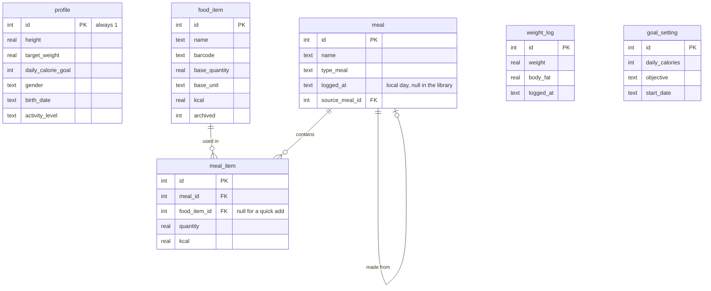

# CatCHMeal

[](./LICENSE)


A personal calorie tracker for Android. It runs entirely on the phone: no account, no server, no shared database. The data lives in SQLite on the device, and only the barcode lookup goes online, to Open Food Facts.

It started from CatCHMeal, a web app built as a team for the ft_transcendence project at 42 (see [LICENSE](./LICENSE)), cut down and rebuilt as a single-user phone app.

## Features

- **Journal**: meals logged per day in four sections (breakfast, lunch, dinner, snack), with calorie and macro progress.
- **Food library**: foods with their values per 100 g, 100 ml or per piece, archived instead of deleted so past meals keep their data.
- **Meal library**: meals saved once and logged again in one go.
- **Quick add**: calories and macros logged without a food.
- **Barcode scanning**: the camera reads EAN and UPC codes, and [Open Food Facts](https://world.openfoodfacts.org) fills the food form.
- **Body composition**: weigh-ins with body fat, fat-free mass, body water and muscle mass.
- **Goals**: daily calories and macros recommended from a goal (lose fat, lose weight, maintain, build muscle) and a weekly pace, never under the BMR. The daily expenditure is measured from the last four weeks of journal and weigh-ins, or estimated (Mifflin-St Jeor or Katch-McArdle) until there is enough data. Past goals are kept for the stats.
- **Statistics**: calorie, macro and body composition charts over a chosen period.
- **Backup and restore**: all the data in one JSON file, shared through Android (Drive, e-mail, Files) and restored all or nothing.
- **Color themes**: twelve themes from known palettes (Graphite, Nord, Dracula, Gruvbox, Catppuccin, Rosé Pine, Tokyo Night, Monokai, Solarized dark and light, navy and coral, Klein and cream), each with two accents, picked in the profile.

## Technical stack

- **React 19**, **TypeScript**, **Vite 8**, **Tailwind CSS 4**, **React Router**, **Recharts**
- **Capacitor 8**: wraps the web app into an Android app and gives it native plugins
- **SQLite** through `@capacitor-community/sqlite`, with versioned migrations (`PRAGMA user_version`)
- **zxing-wasm** for barcode decoding in the WebView
- **Vitest** for the tests: the business rules and the SQL run against a real SQLite database in Node

### Code layout

| Folder | Content |
|---|---|
| `src/db` | The database layer: one queue for every statement, transactions, migrations |
| `src/data` | The business rules and SQL of each feature, tested in Node |
| `src/native` | The Android-only parts: back button, native HTTP, backup files |
| `src/components`, `src/pages` | The screens; each feature's `api.ts` connects them to `data` |
| `android` | The Android project generated by Capacitor |

## Data model



A meal line stores the calories and macros computed when the meal is saved, so editing or archiving a food later leaves past meals unchanged.

## Building and installing

### Requirements

- Node.js 22 or newer
- JDK 21 and the Android SDK (platform 36), with `ANDROID_HOME` and `JAVA_HOME` set
- An Android phone with USB debugging enabled, visible in `adb devices`

On WSL, the phone is passed to Linux with [usbipd-win](https://github.com/dorssel/usbipd-win): `usbipd attach --wsl --busid <BUSID> --auto-attach`.

### Commands

```bash
npm ci       # install the dependencies
make check   # format, lint, build and tests, like the CI
make phone   # build and install the app on the phone
```

For live development, run `make dev` in one terminal and `make live` in another: the phone loads the code from the computer through the USB cable and reloads on every change. Stop `make live` with Ctrl+C, then run `make phone` to install the normal app again.

## Data and backup

Uninstalling the app deletes its data, and Android refuses an update signed with another key. Keep a copy of the signing key (`~/.android/debug.keystore`), and export a backup regularly from the profile page.

## Resources

- [Capacitor](https://capacitorjs.com/docs)
- [@capacitor-community/sqlite](https://github.com/capacitor-community/sqlite)
- [Open Food Facts API](https://openfoodfacts.github.io/openfoodfacts-server/api)
- [React](https://react.dev), [Tailwind CSS](https://tailwindcss.com/docs), [Recharts](https://recharts.org), [Vitest](https://vitest.dev)

> Food product data comes from [Open Food Facts](https://world.openfoodfacts.org), a free, open and collaborative database licensed under the [Open Database License (ODbL)](https://opendatacommons.org/licenses/odbl/1-0/).
